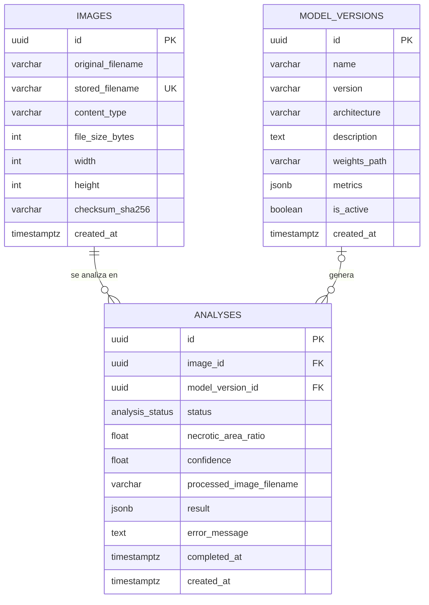

# Diseño de base de datos — DermAI

Motor: **PostgreSQL 16** · ORM: **SQLAlchemy 2.0** · Migraciones: **Alembic** · Driver: **psycopg 3**

## 1. Modelo entidad-relación



- Una **imagen** puede tener **cero o muchos análisis** (p. ej. al reanalizarla con otra versión del modelo).
- Un **análisis** pertenece a **una imagen** y, opcionalmente, a **una versión de modelo**. Un análisis sin modelo sirve para ejecutar solo el preprocesamiento.

## 2. Tablas

### `images`
Metadatos técnicos de cada fotografía cargada. El archivo se guarda en `STORAGE_PATH/<stored_filename>`; la base de datos solo guarda la referencia.

| Columna | Tipo | Restricciones | Descripción |
|---|---|---|---|
| `id` | UUID | PK | Identificador |
| `original_filename` | VARCHAR(255) | NOT NULL | Nombre original del archivo subido |
| `stored_filename` | VARCHAR(255) | NOT NULL, UNIQUE | Nombre interno en el almacenamiento |
| `content_type` | VARCHAR(50) | NOT NULL | Tipo MIME (`image/jpeg`, `image/png`) |
| `file_size_bytes` | INTEGER | NOT NULL, > 0 | Tamaño del archivo |
| `width`, `height` | INTEGER | NULL o > 0 | Dimensiones en píxeles |
| `checksum_sha256` | VARCHAR(64) | NOT NULL, indexado | Huella para detectar duplicados |
| `created_at` | TIMESTAMPTZ | NOT NULL, `now()` | Fecha de carga |

### `model_versions`
Registro de versiones de los modelos experimentales, para saber qué modelo produjo cada resultado.

| Columna | Tipo | Restricciones | Descripción |
|---|---|---|---|
| `id` | UUID | PK | Identificador |
| `name`, `version` | VARCHAR | NOT NULL, UNIQUE (name, version) | Nombre y versión del modelo |
| `architecture` | VARCHAR(100) | — | Arquitectura (p. ej. U-Net) |
| `description` | TEXT | — | Notas del experimento |
| `weights_path` | VARCHAR(500) | — | Ruta a los pesos (no versionados en git) |
| `metrics` | JSONB | — | Métricas de evaluación (Dice, IoU, etc.) |
| `is_active` | BOOLEAN | NOT NULL, `false` | Modelo usado por defecto |
| `created_at` | TIMESTAMPTZ | NOT NULL | Fecha de registro |

### `analyses`
Cada ejecución del pipeline de análisis sobre una imagen.

| Columna | Tipo | Restricciones | Descripción |
|---|---|---|---|
| `id` | UUID | PK | Identificador |
| `image_id` | UUID | FK → `images`, `ON DELETE CASCADE`, indexado | Imagen analizada |
| `model_version_id` | UUID | FK → `model_versions`, `ON DELETE RESTRICT`, indexado | Modelo usado (opcional) |
| `status` | ENUM `analysis_status` | NOT NULL, `pending`, indexado | `pending`, `processing`, `completed`, `failed` |
| `necrotic_area_ratio` | FLOAT | NULL o entre 0 y 1 | Proporción estimada del área con características compatibles con tejido necrótico |
| `confidence` | FLOAT | NULL o entre 0 y 1 | Confianza del modelo |
| `processed_image_filename` | VARCHAR(255) | — | Imagen procesada o máscara en el almacenamiento |
| `result` | JSONB | — | Salida detallada (características, regiones, etc.) |
| `error_message` | TEXT | — | Motivo del fallo si `status = failed` |
| `completed_at` | TIMESTAMPTZ | — | Fin del análisis |
| `created_at` | TIMESTAMPTZ | NOT NULL | Creación del análisis |

> Los valores de `analyses` son **salidas experimentales**, nunca un diagnóstico médico.

## 3. Decisiones de diseño

- **UUID como clave primaria:** los identificadores no revelan cuántos registros hay y se pueden generar en la aplicación.
- **Las imágenes no se guardan en la base de datos:** solo nombres de archivo relativos a `STORAGE_PATH`, para poder mover el almacenamiento sin tocar los datos.
- **Sin datos personales:** no hay tablas de pacientes ni campos identificables, conforme al [alcance](project-scope.md).
- **`ON DELETE CASCADE`** de imagen a análisis: borrar una imagen elimina sus resultados.
- **`ON DELETE RESTRICT`** de versión de modelo a análisis: no se puede borrar un modelo con resultados asociados (trazabilidad).
- **JSONB** para métricas y resultados: el formato de salida del modelo evolucionará durante la investigación.
- **Restricciones CHECK** para garantizar rangos válidos (tamaños positivos, proporciones entre 0 y 1).
- **Convención de nombres** de índices y restricciones (`pk_`, `uq_`, `ix_`, `fk_`, `ck_`) para que las migraciones sean deterministas.

## 4. Código relacionado

| Archivo | Contenido |
|---|---|
| `backend/app/models/` | Modelos ORM (`Image`, `ModelVersion`, `Analysis`) |
| `backend/app/core/database.py` | Engine, sesiones y dependencia `get_db` |
| `backend/alembic/versions/0001_initial_schema.py` | Migración inicial |
| `tests/backend/test_models.py` | Pruebas de modelos y restricciones |
| `tests/backend/test_migrations.py` | Pruebas de migración (ida/vuelta, coherencia con modelos, SQL PostgreSQL) |
| `tests/backend/test_postgres_integration.py` | Pruebas contra PostgreSQL real (se omiten si no está disponible) |
| `docker-compose.yml`, `scripts/db-init.ps1` | Servidor PostgreSQL de desarrollo |

## 5. Servidor de desarrollo (Docker)

El PostgreSQL de desarrollo se ejecuta en un contenedor definido en `docker-compose.yml` (raíz del proyecto):

| Elemento | Valor |
|---|---|
| Imagen | `postgres:16` |
| Contenedor | `dermai-db` |
| Puerto | `127.0.0.1:5433` (solo accesible desde este equipo; 5433 evita conflictos con otros PostgreSQL en 5432) |
| Volumen de datos | `dermai_pgdata` |
| Credenciales | En `.env` (no versionado), generadas por `scripts/db-init.ps1` |

```powershell
powershell -ExecutionPolicy Bypass -File scripts\db-init.ps1   # primera vez: genera .env y levanta el contenedor
docker compose up -d --wait                                     # arrancar
docker compose stop                                             # detener (conserva los datos)
docker compose down -v                                          # eliminar contenedor Y datos
```

> En Windows, `DATABASE_URL` usa `127.0.0.1` y no `localhost`: `localhost` resuelve primero a IPv6 (`::1`) y Docker Desktop deja esa conexión colgada.

> La imagen oficial de PostgreSQL crea `POSTGRES_USER` (`dermai_user`) como **superusuario**. Es aceptable en este entorno local, aislado y accesible solo desde `127.0.0.1`. En cualquier entorno compartido la aplicación debe usar un rol sin privilegios de superusuario.

## 6. Comandos de migración

Desde `backend/`, con `DATABASE_URL` configurada en el `.env` de la raíz:

```powershell
.\.venv\Scripts\python -m alembic upgrade head                              # aplicar migraciones
.\.venv\Scripts\python -m alembic downgrade -1                              # revertir la última
.\.venv\Scripts\python -m alembic current                                   # versión aplicada
.\.venv\Scripts\python -m alembic upgrade head --sql                        # ver el SQL sin ejecutarlo
.\.venv\Scripts\python -m alembic revision --autogenerate -m "descripcion"  # nueva migración
```
